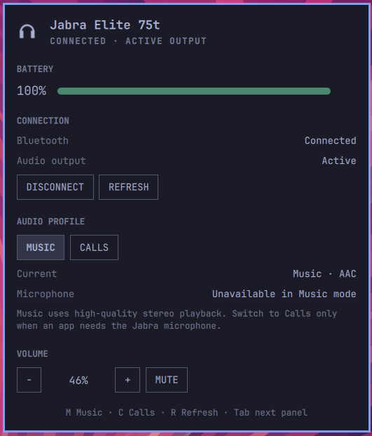

# Omajabra

Omajabra is an independent Omarchy Quattro plugin for Jabra Bluetooth headsets and earbuds. It puts connection state and battery in the bar, then opens a native panel for audio profiles, output selection, volume, and mute.



The plugin uses the standard Linux Bluetooth and audio stacks — no Jabra account, cloud service, partner key, or daemon. The one exception is switching on DSP sidetone when you enter Calls mode, which the Elite line exposes only through an unofficial serial protocol; see [Sidetone in Calls](#sidetone-in-calls).

## Features

- Automatic discovery of paired Jabra devices.
- Connected/disconnected state and aggregate battery from BlueZ.
- Current PipeWire codec, profile, volume, mute, output, and microphone state.
- Connect, disconnect, and select the Jabra as the current audio output.
- Explicit **Music** and **Calls** modes, choosing the best available A2DP and HFP/HSP profiles.
- Optional battery percentage in the bar and optional hiding while disconnected.
- Keyboard shortcuts in the panel: `M` for Music, `C` for Calls, and `R` to refresh.

## Music and Calls modes

**Music** selects the highest-priority A2DP profile exposed by PipeWire. On a Jabra Elite 75t this is high-quality stereo AAC. The headset microphone is unavailable in this mode.

**Calls** selects the highest-priority HFP/HSP profile. On the same Elite 75t this is mSBC, with simultaneous microphone and playback but substantially lower-bandwidth mono audio.

Omajabra never switches profiles automatically. An application or WirePlumber may still request Calls mode when it starts recording, depending on the user's audio policy.

## Sidetone in Calls

Sidetone lets you hear your own voice while talking. On the Elite line it is not reachable through BlueZ, so when you switch to Calls **through Omajabra**, the plugin enables it over **GNP**, an unofficial serial protocol reverse-engineered from black-box observation of an Elite 75t. It talks to no Jabra binary, SDK, or cloud service.

This is a best-effort side effect: if the headset does not speak the protocol, the profile switch still succeeds and nothing else happens. Enabling sidetone **writes a persistent setting** to the headset that survives disconnects, exactly like changing it in Jabra's own app. Set `OMAJABRA_SIDETONE_IN_CALLS=0` in the plugin's environment to turn the behaviour off. HearThrough is not controlled by the plugin — toggle it with the earbud's own tap gesture.

Tested only on the Jabra Elite 75t.

## Device limitations

BlueZ exposes one aggregate battery value for the Elite 75t rather than independent left, right, and case battery levels. Some settings available in Jabra's mobile application are not exposed through the standard Linux Bluetooth interface.

Omajabra deliberately displays only controls it can reliably read back and apply.

## Install

Once published at `https://github.com/dupontbertrand/omajabra`:

```sh
omarchy plugin add https://github.com/dupontbertrand/omajabra --enable --yes
```

The widget is placed on the right side of the bar. Pair the Jabra through Omarchy's standard Bluetooth panel; Omajabra then discovers it automatically.

For local development, add this checkout by path and rescan plugins. Do not symlink it into the plugins directory — the Quattro validator rejects symlinked plugins:

```sh
omarchy plugin add "$PWD" --enable --section right
omarchy-shell shell rescanPlugins
```

## Requirements

- Omarchy Quattro 4.0 or newer.
- Python 3.
- BlueZ and `bluetoothctl`.
- PipeWire/WirePlumber tools `wpctl` and `pw-cli` for audio controls.
- A paired Jabra Bluetooth audio device. Initial development is tested with Jabra Elite 75t.

The stock Omarchy installation already provides these Linux tools.

## Command line

The UI runs the plugin-local backend, which is also useful for diagnostics:

```sh
OMAJABRA="$HOME/.config/omarchy/plugins/io.github.dupontbertrand.omajabra/bin/omajabra"

"$OMAJABRA" status --pretty
"$OMAJABRA" connect
"$OMAJABRA" activate
"$OMAJABRA" profile music
"$OMAJABRA" profile calls
"$OMAJABRA" volume-step -5
"$OMAJABRA" mute toggle
```

Set `OMAJABRA_DEVICE` to a Bluetooth MAC address to prefer one device when several paired Jabra devices are present. Set `OMAJABRA_MOCK_FILE` to a JSON status fixture for visual development without Bluetooth hardware. A deliberately created `~/.config/omajabra/mock.json` provides the same development-only fallback when the shell launcher does not forward environment variables; Omajabra never creates that file itself.

## Security and privacy

Omajabra runs locally and sends no device information anywhere. It invokes `bluetoothctl`, `wpctl`, and `pw-cli` with fixed verbs and validated identifiers, always as separate process arguments and never through a shell. It uses no `sudo` and makes no privileged system change. When you enter Calls mode it also opens an RFCOMM channel to the headset to enable sidetone; that channel carries only that one setting and reaches no other device or service.

Like every Omarchy plugin, its QML and local executable run unsandboxed with the user's permissions. Inspect the source before enabling it.

## Uninstall safely

```sh
omarchy plugin remove io.github.dupontbertrand.omajabra
```

Omajabra installs no service and writes no persistent state on your system, so no additional cleanup is required. Removing it does not unpair or reconfigure the Jabra. If you used Calls mode, sidetone stays enabled on the headset — as it would after using any Jabra app — and is not reset by removing the plugin.

## Development

```sh
python3 -m unittest discover -s tests -v
python3 -m py_compile bin/omajabra
omarchy plugin validate .
```

The project was informed by the interaction patterns documented by [omarchy-airpods](https://github.com/s0up4200/omarchy-airpods) and [omarchy-pods](https://github.com/thisisgm/omarchy-pods), but is an original implementation using standard BlueZ and PipeWire interfaces.

Jabra is a trademark of GN Audio A/S. This project is not affiliated with or endorsed by GN Audio.

MIT licensed.
